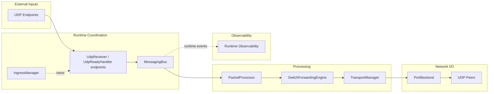

# EdgeNetSwitch


> Debugging embedded network systems after hardware integration is too late.  
> EdgeNetSwitch is a deterministic C++20 runtime for validating and reasoning about networked systems before hardware exists.

## Problem

Embedded networking systems are often debugged too late: after hardware is available, after kernel integration has started, and after concurrency bugs are already mixed with driver, BSP, and timing behavior.

That makes packet loss, shutdown races, observability gaps, and lifecycle accounting errors difficult to reproduce. The core runtime needs to be designed and validated before it is buried under platform-specific complexity.

## Solution

EdgeNetSwitch models a small network runtime in C++20. UDP traffic enters through configured ingress endpoints, packets move through a synchronous event bus and bounded worker handoffs, switching decisions are computed in-process, and runtime state is inspected through a UNIX-socket control plane.

The runtime keeps concurrency, resource ownership, overload behavior, telemetry, replay, failure injection, and shutdown sequencing explicit so they can be tested before hardware or kernel integration hides the failure modes.

The system enables early validation of:
- how packets enter, move through, and complete inside the daemon
- where concurrency, ownership, and bounded handoff boundaries sit
- how overload, descriptor lifecycle, and shutdown behavior are reported
- whether replay, failure-injection, and switching scenarios produce expected outcomes
- what telemetry and control-plane views expose while the runtime is active

## Key Engineering Highlights

- C++20 runtime ownership: RAII descriptors, explicit worker shutdown, admission closure, deterministic drain/join, and a lost-wakeup-safe condition-variable protocol.
- Multi-endpoint UDP ingress: `IngressManager` owns endpoints mapping logical ports to independent listen/peer addresses; readiness dispatch drains at most 256 datagrams.
- Linux receive observability: `recvmsg()`, `SO_TIMESTAMPNS` / `SCM_TIMESTAMPNS`, `SO_RXQ_OVFL`, receive timing, and socket-buffer snapshots; `MSG_TRUNC` becomes `DatagramTruncated` before parsing.
- Explicit concurrency boundaries: synchronous `MessagingBus` callbacks and bounded packet admission with classified `QueueOverflow` drops.
- Bounded asynchronous telemetry: drop-oldest eviction, `dropped_count`, per-exporter exception isolation, and deterministic shutdown drain.
- Lifecycle identity and accounting: shared `LifecycleIdGenerator` for UDP/control traffic, separate `Packet::id` and `lifecycle_id`, active lifecycle tracking, duplicate terminal detection, and completed-range compression.
- Replay and deterministic failure injection: recorded outcomes, loss, delay, and rejection scenarios can be reproduced and checked.
- Learning-switch forwarding: MAC learning, aging, flooding, and known-unicast decisions feed `TransportManager` and `PortBackend`; `ForwardingDecisionMade` precedes terminal processing.
- Operational visibility: packet queue depth/capacity/high-water mark, rates, latency, distinct drop reasons, forwarding counters, requested-port egress attribution, and heartbeat silence.
- Operational health: `Healthy`, `Degraded`, `Overloaded`, and `ShuttingDown` describe operating condition separately from lifecycle `RuntimeState`.
- Graceful degradation: regressions verify continued processing after localized packet/transport failures, exporter-worker survival, and rejected post-stop processor admission.
- Linux readiness and shutdown: `epoll` handles UDP/control I/O, `eventfd` wakes shutdown, stop-before-run is safe, and `SIGINT` / `SIGTERM` retain distinct shutdown reasons.
- UNIX-domain control plane: synchronized snapshots, config, health, packet/descriptor/MAC-table state, and deterministic packet injection.

Completed ranges compress the normal monotonic lifecycle model; arbitrary indefinitely sparse IDs can still grow retained ranges. Teardown quiesces ingress/control producers before `PacketProcessor::stop()`, which is not a global callback synchronization barrier.

## v2.0 — Runtime Maturity

v2.0 matures the existing packet architecture through deterministic lifecycle/shutdown, safe concurrency boundaries, bounded asynchronous telemetry, correct lifecycle accounting, operational visibility/health, and graceful-degradation and recovery validation. See the [development record](docs/development/v2.0-runtime-maturity.md) for engineering reasoning and the [release document](docs/releases/v2.0-runtime-maturity.md) for final contracts and boundaries.

## Architecture Overview



`IngressManager` owns one `UdpReceiver` / `UdpReadyHandler` pair per configured endpoint. Runtime Observability combines `PacketStats`, `HealthMonitor`, and asynchronous `TelemetryExportManager` exports. Detailed component and lifecycle contracts are in [docs/](docs/).

## Transport Layer

The transport layer connects switching decisions to outbound packet I/O.

`PortBackend` returns a `TransmitResult` with status `Success`, `BackendUnavailable`, `PortDown`, `InvalidPacket`, or `SendFailed`. `VirtualPortBackend` simulates transmission; `UdpPortBackend` sends payload bytes to configured IPv4 peers using an RAII `FileDescriptor`, optionally tracked in `FdRegistry`.

`TransportManager` owns registered backends and is authoritative for requested egress-port attribution, including when a backend returns an incorrect port ID. Transport counters expose successful packets/bytes, failed attempts, unavailable backends, down ports, and invalid packets through synchronized value snapshots.

Transport failure does not automatically generate `PacketDropped`; the lifecycle can still complete with `PacketProcessed`. Likewise, `ForwardingAction::Drop != PacketDropped`: forwarding decisions and terminal lifecycle outcomes are counted separately.

```bash
echo "1.2|transport-stats" | nc -U /tmp/edgenetswitch.sock
echo "1.2|transport-stats:json" | nc -U /tmp/edgenetswitch.sock
```

## Focused Architecture Documents

- [v2.0 development record](docs/development/v2.0-runtime-maturity.md) records lifecycle, telemetry, concurrency, accounting, observability, and graceful-degradation reasoning and validation history.
- [v2.0 release document](docs/releases/v2.0-runtime-maturity.md) defines final runtime contracts, validated capabilities, known boundaries, and the next milestone.
- [Runtime flow](docs/runtime/flow.md) covers the daemon loop, `MessagingBus`, packet lifecycle, replay hooks, telemetry ticks, and signal-aware shutdown behavior.
- [Epoll shutdown wakeup flow](docs/system/epoll-shutdown-wakeup-flow.md) explains the `epoll` / `eventfd` wakeup path used to stop the readiness loop.
- [v1.9.4 signal shutdown investigation](docs/investigations/v1.9.4-signal-runtime-investigation.md) documents the signal-safe boundary, `SIGINT` / `SIGTERM` differentiation, and shutdown latency finding.
- [v1.9.7 kernel packet path visibility](docs/development/1.9.7-kernel-packet-path-visibility.md) documents `recvmsg()`, ancillary metadata, kernel receive timestamps, receive-queue drops, socket receive-buffer visibility, truncation semantics, MTU/fragmentation experiments, and bounded ingress behavior under pressure.
- [v1.9.8 Linux packet path exploration](docs/development/v1.9.8-linux-packet-path-exploration.md) compares AF_PACKET, UDP sockets, TAP/TUN, Linux bridge forwarding, and RSS/RPS/RFS configuration through reproducible experiments.
- [Daemon and MessagingBus architecture](docs/architecture/daemon.md) describes daemon composition, event dispatch, and control-plane integration.

## Tech Stack

- C++20, CMake
- Catch2 for unit coverage
- nlohmann/json for configuration and control responses
- POSIX UDP sockets and UNIX domain sockets
- Linux `epoll` and `eventfd`
- `std::thread`, `std::mutex`, `std::condition_variable`, atomics
- macOS and Linux targets

## Changelog

See [CHANGELOG.md](CHANGELOG.md) for the architectural milestone history and release-level engineering notes.

## Current Status

v2.0 Runtime Maturity is complete. Lifecycle/shutdown, telemetry, and operational visibility/health work is complete, with regression coverage for graceful degradation and failure recovery. Final regression and sanitizer validation passed.

Next: **v2.5 — ARM64 / QEMU integration**, including systemd and boot-time daemon validation. Later: **v3.0 — Yocto integration and complete embedded Linux simulation**.

## Intended Audience

This project is designed for engineers working on:
- embedded systems
- network runtimes
- event-driven architectures
- deterministic systems and observability

## Getting Started

### Clone

```bash
git clone https://github.com/togunchan/EdgeNetSwitch.git
cd EdgeNetSwitch
git submodule update --init --recursive
```

### Build

```bash
cmake -S . -B build -DBUILD_TESTING=ON
cmake --build build
```

### Run

```bash
./build/EdgeNetSwitchDaemon
```

### Verify

```bash
ctest --test-dir build --output-on-failure
```

The full Linux CTest suite passed **22/22** targets. The [final validation record](docs/development/v2.0-runtime-maturity.md#final-v20-validation) also records **22/22** passing under AddressSanitizer + UndefinedBehaviorSanitizer, with the final run using `ASAN_OPTIONS=detect_leaks=1` and `UBSAN_OPTIONS=print_stacktrace=1`.

Coverage includes lifecycle/drain, telemetry recovery, control admission, accounting, queue pressure, health, replay, MAC learning/aging, multi-endpoint forwarding, descriptor ownership, and `epoll` / `eventfd`. These results validate the executed regressions, not every possible concurrency interleaving.

## Quick Demo (No Hardware Required)

Send a valid packet to any configured ingress endpoint:

```bash
printf 'id=1;\nsrc=00:11:22:33:44:55;\ndst=ff:ff:ff:ff:ff:ff;\npayload=Hello EdgeNetSwitch\n' \
| nc -u 127.0.0.1 9001

printf 'id=2;\nsrc=00:11:22:33:44:66;\ndst=ff:ff:ff:ff:ff:ff;\npayload=Hello EdgeNetSwitch\n' \
| nc -u 127.0.0.1 9002
```

Inspect system state:

```bash
echo "1.2|status" | nc -U /tmp/edgenetswitch.sock
echo "1.2|packet-stats:json" | nc -U /tmp/edgenetswitch.sock
echo "1.2|ingress-stats:json" | nc -U /tmp/edgenetswitch.sock
echo "1.2|fd-status" | nc -U /tmp/edgenetswitch.sock
echo "1.2|fd-status:json" | nc -U /tmp/edgenetswitch.sock
echo "1.2|show-config:json" | nc -U /tmp/edgenetswitch.sock
```

Inject deterministic switching traffic through the control plane:

```bash
echo "1.2|send-packet:broadcast" | nc -U /tmp/edgenetswitch.sock
echo "1.2|send-packet:learn" | nc -U /tmp/edgenetswitch.sock
echo "1.2|send-packet:topology-demo" | nc -U /tmp/edgenetswitch.sock
echo "1.2|show:mac-table" | nc -U /tmp/edgenetswitch.sock
```

This demonstrates multi-endpoint ingress, operational health, lifecycle tracking, MAC learning, forwarding and descriptor visibility, and configuration inspection without hardware dependencies.

## Contributing

This project is primarily a systems architecture exploration.

Contributions, experiments, and technical discussions are welcome.

Open an issue for:
- architecture ideas
- runtime experiments
- documentation improvements

## Contact
[](https://www.linkedin.com/in/togunchan/)
[](https://github.com/togunchan)
